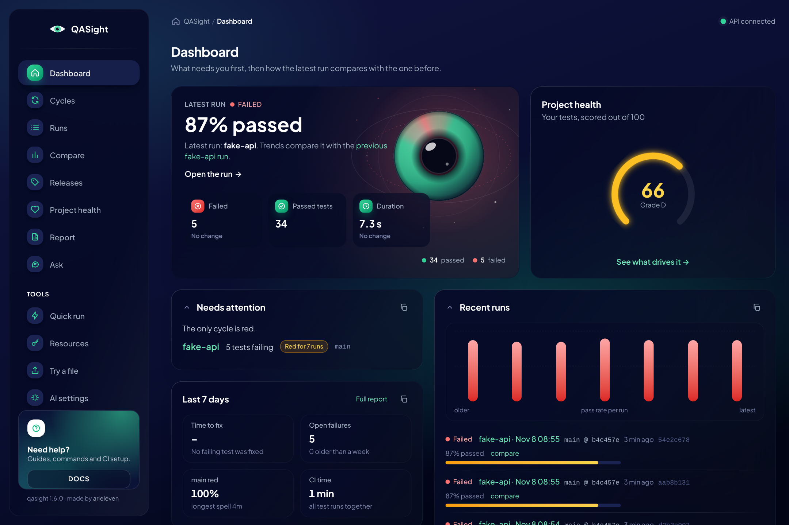
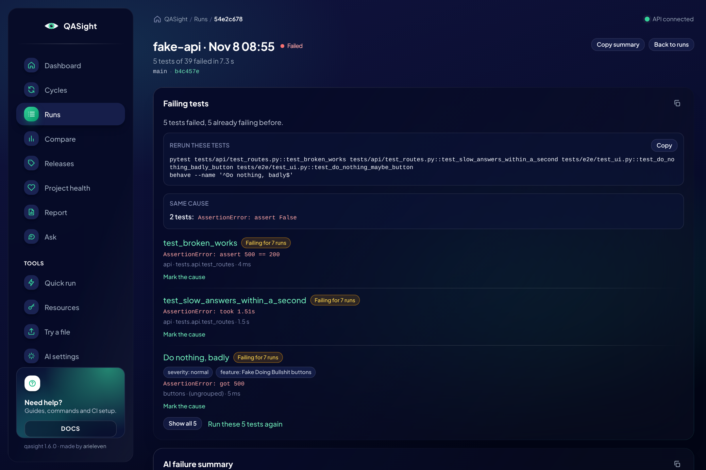
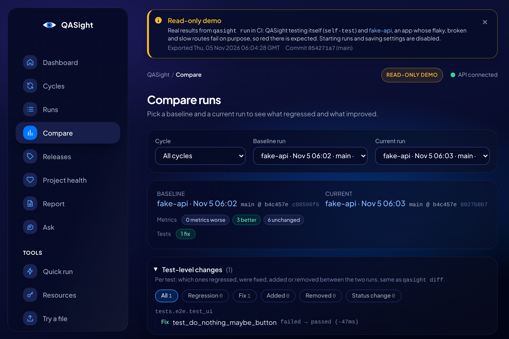
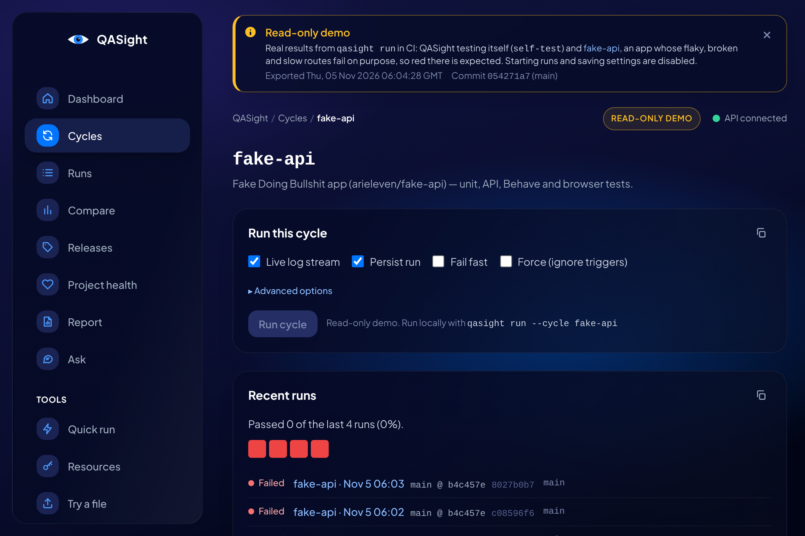
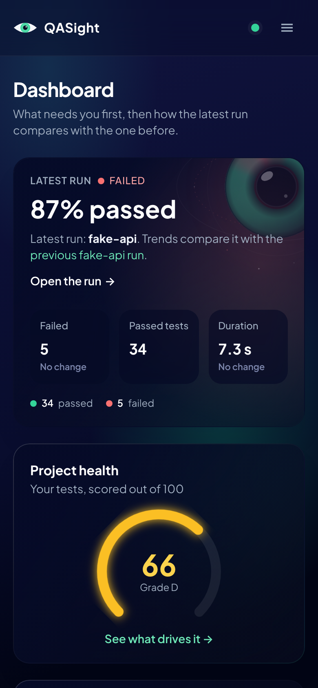
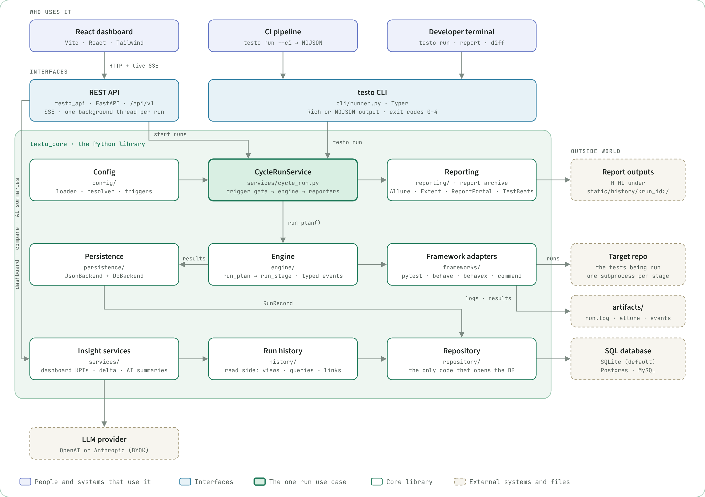

<h1>
  <picture>
    <source media="(prefers-color-scheme: dark)" srcset="docs/assets/qasight-logo-dark.png">
    
  </picture>
</h1>

_Formerly Testosterone (`testo-core`). Old commands, imports and config files keep working; see [the rename notes](docs/Specs%20%26%20ADRs/Rename%20to%20QASight%20-%202026-11-04.md)._

**Run and track your tests, compare and export results, and catch the flaky ones.** Get deeper insight with AI, using your own model. On your laptop, in CI, or on one shared server for the whole team.

[](https://github.com/arieleven/qasight/actions/workflows/ci.yml)
[](https://pypi.org/project/qasight/)
[](https://pypi.org/project/qasight/)
[](https://arieleven.github.io/qasight/docs/)
[](LICENSE)

**▶ Try it now, no install: drop a JUnit XML file on <https://arieleven.github.io/qasight/try>** and see what failed, what's flaky and what's slow. It's read in your browser; nothing is uploaded.

**Live demo: <https://arieleven.github.io/qasight/>** · **Docs: <https://arieleven.github.io/qasight/docs/>**

[](https://arieleven.github.io/qasight/)

| Run detail (failed fake-api run) | Compare (two fake-api runs) |
|---|---|
| [](docs/assets/screenshots/run-detail-failed-fake-api.png) | [](docs/assets/screenshots/compare-fake-api-runs.png) |
| **Cycle page with its flaky tests** | **Dashboard on a phone** |
| [](docs/assets/screenshots/cycle-detail-fake-api.png) | <a href="docs/assets/screenshots/dashboard-phone.png"></a> |

What you're looking at: QASight testing itself (its own test suite) and `fake-api`, a
small app whose routes fail on purpose. CI runs both cycles and publishes the real results as a
read-only static site.

<details>
<summary><strong>Watch a walkthrough of the UI</strong> (animated, under a minute)</summary>


</details>

**Set it up in a minute** on a project you already have:

```bash
pip install 'qasight[api]'
qasight init        # finds your test runners, writes qasight.yaml and a GitHub Actions workflow, records a first run
qasight ui          # what broke, what's flaky, what got slower
```

`qasight init --dry-run` shows the files first; `qasight init --pr` also opens the pull request that
adds them. Only want to record? `pytest --qasight`, or `qasight ingest` after any runner.

No tests at hand? `qasight demo` records eight sample runs (a flaky test, a new failure, a slower
test) and opens the UI on them. More ways in, from Jest to `go test`, are in the [Quickstart](#quickstart).

## What's new

1.6.0 renames Testosterone to QASight (`pip install qasight`; the old `testo` command, config
file and `testo-core` package keep working) and adds `qasight init` to set a project up in one
command, a Report page and `qasight export` for managers, `qasight demo`, `qasight try`,
`qasight mcp`, `qasight export-site` for a read-only history site on GitHub Pages, quarantine from the UI, releases and environments on runs, and storage limits for
the team server. 1.5.0 added `qasight affected`, OpenTelemetry export and `qasight pool`. 1.4.0 brought `qasight ingest` for Jest, Vitest, .NET, Go, Robot,
Allure, RSpec, k6 and Xcode results, `pytest --qasight` and the GitHub Action at
`uses: arieleven/qasight@v1`. Every change is in [CHANGELOG.md](CHANGELOG.md).

## Who it's for

- **Teams whose CI goes red and someone has to ask "is this new, flaky or just slow?"** QASight
  answers that from the JUnit XML (or Jest, Playwright, `go test`, .NET...) results you already have.
- **People who want it self-hosted and free**: a `pip install` on a laptop, or one
  `docker compose up` for a shared team server. No account, no cloud, MIT licensed.

Not the right pick if you want a hosted SaaS with nothing to run, or full manual test case
management. The [comparison page](https://arieleven.github.io/qasight/docs/compared-with-other-tools/)
says which tool fits better then.

## Why

After a red build the question is never just "what failed?". It's *what changed since the last
green run, is this test flaky, and did anything get slower?* CI logs and one-off HTML reports
can't answer that, because they forget every run as soon as it ends. QASight records every
run and answers it: per-test regressions and fixes between runs, flaky tests, durations over
time, a test pyramid and an optional AI summary of the failures.

There are two ways in. **`qasight ingest`** records JUnit XML that your existing CI already writes,
so adoption is one extra step. **`qasight run`** goes further: it runs several frameworks as one
**cycle** of stages from a `qasight.yaml` (pytest, Playwright, Behave, any command), the
same way from the CLI, CI or the web UI. Point either at a shared
[team server](https://arieleven.github.io/qasight/docs/processes-and-guides/team-server/) and every CI job lands in one history.

**How it compares.** Allure renders one run; ReportPortal is a large server to operate.
QASight is a `pip install` that keeps the history and diffs runs against each other, works
with whatever runner you have, and can still hand results to Allure, ReportPortal, Extent or
TestBeats as reporters. The [comparison page](https://arieleven.github.io/qasight/docs/compared-with-other-tools/) has the details, including when another tool is the better pick.

<picture>
  <source media="(prefers-color-scheme: dark)" srcset="docs/assets/qasight-architecture-detailed-dark.png">
  
</picture>

What ships: the `qasight` CLI (`--ci` streams NDJSON events, exit codes `0`–`4`), a FastAPI
backend (`qasight_api`, `/api/v1`, live runs over server-sent events), a React frontend
(`frontend/`), and GitHub Action / GitLab CI wrappers around `qasight run --ci`. See
[ARCHITECTURE.md](ARCHITECTURE.md) for how the pieces fit.

## Quickstart

The shortest path, for pytest, Jest, Vitest, Playwright, Go, .NET, Maven, Gradle, RSpec and PHPUnit:

```bash
pip install qasight
qasight init --dry-run   # what it would write: qasight.yaml, .github/workflows/qasight.yml, .gitignore lines
qasight init --pr        # writes them, records a first run and opens a pull request (needs gh; without it, prints the git commands)
```

No Python project? `uvx --from qasight qasight init` or `pipx run --spec qasight qasight init` runs it without
a virtualenv. Other CI systems: `qasight init --ci gitlab|jenkins|circleci`.

Already have tests that write JUnit XML, or a runner's own report? Record them, no config needed:

```bash
pip install qasight
npx jest --ci --json --outputFile=jest.json   # or pytest --junitxml, go test -json, ...
qasight ingest jest.json --cycle web            # recorded; run again to see the diff
qasight summary --cycle web
```

Using pytest? `pytest --qasight` records every run the same way, with no extra step.

Or let QASight run the tests as a cycle:

```bash
pip install qasight            # the `qasight` CLI; add [api] for the REST API, [db] for Postgres,
                                  # [bdd] for Behave and BehaveX
qasight config init                 # writes a starter qasight.yaml for pytest
qasight run --cycle smoke-test      # runs pytest -q tests; edit args for a different test directory
```

An installed `qasight` keeps per-run report copies in `./.testo/` (set `TESTO_HOME` to move them).

[Getting Started](https://arieleven.github.io/qasight/docs/getting-started/) goes further in about five minutes: a regression
between two runs, then the same cycle in GitHub Actions.

Or work from a checkout of this repository, which ships sample cycles:

```bash
git clone https://github.com/arieleven/qasight.git
cd qasight
python -m venv .venv && source .venv/bin/activate
pip install -e ".[dev]"

qasight run --cycle sample-pytests      # run a cycle from qasight.yaml
qasight report --cycle sample-pytests   # build the Allure report for it
```

<details>
<summary><strong>Watch it run</strong>: install, <code>qasight doctor</code>, then a cycle against the deliberately broken fake-api app</summary>


</details>

Adding QASight to your own project with an AI coding assistant? Paste one of the
[Setup Prompts](https://arieleven.github.io/qasight/docs/prompts-and-snippets/setup-prompts/).

Runs are stored in SQLite by default (`database.url` in `qasight.yaml`, or
`DATABASE_URL`). Postgres and MySQL work too; `docker compose up -d postgres` starts one.

### UI

```bash
pip install 'qasight[api]'
qasight ui                               # API + web UI on http://127.0.0.1:8000, opens the browser
```

The wheel carries a built UI (1.3.0 and later), so this needs no checkout and no Node.
Working on the frontend itself:

```bash
qasight-api                              # FastAPI on http://127.0.0.1:8000
npm --prefix frontend install
npm --prefix frontend run dev          # React on http://localhost:5173
```

Pages: Dashboard (what needs attention first), Cycles (run any cycle and watch its stages live,
see its flaky tests), Runs and Run Detail (failing tests first, reports, test pyramid, AI summary),
a page per test (history, attachments, Playwright trace), Compare (delta between two runs),
Project health, Resources, Quick Run (run one framework against a repo without defining a cycle)
and AI settings.

## Defining cycles

```yaml
version: 1
defaults:
  target_repo: .
  artifacts_root: artifacts
  timeout_s: 600
reporters:
  - type: allure
cycles:
  smoke:
    description: Unit tests, then BDD flows.
    trigger:                     # optional: skip unless these paths changed
      paths: ["src/**", "tests/**"]
    stages:
      - name: unit
        equipment: pytest
        args: [-q, tests/unit]
      - name: flows
        equipment: behave
        args: [features/smoke.feature]   # always target Behave features explicitly
      - name: browser
        equipment: playwright            # npx playwright test, JUnit + HTML report wired in
        args: [tests/e2e]
      - name: web
        equipment: command               # any runner; results come from JUnit XML
        args: [npx, jest, --ci]
        junit_xml: ["reports/junit/*.xml"]
```

Built-in `equipment`: `pytest`, `behave`, `behavex`, `playwright`, `command` and `junit` (records
JUnit XML another step wrote; what `qasight ingest` uses). `behave` and `behavex` need
`pip install 'qasight[bdd]'`. A package can add more (see [Plugins](#optional-integrations)).

`qasight init` writes one for you (it detects pytest, Jest, Vitest, Go, .NET, Maven, Gradle, RSpec
and PHPUnit, and also writes the GitHub Actions workflow); `qasight config validate` checks it. The full
schema and every flag are in [Command Reference](https://arieleven.github.io/qasight/docs/cli-commands/command-reference/).

## CLI

| Command | What it does |
|---------|--------------|
| `qasight run --cycle <name>` | Run a cycle (`--ci` NDJSON, `--stream` live output, `--force` ignore triggers, `--no-persist`) |
| `qasight ingest <files> --cycle <name>` | Record JUnit XML from any runner as a run (`--server`/`--token` upload to a team server) |
| `qasight report …` | Generate, list, open and export reports (`qasight diff` compares two archived runs) |
| `qasight report markdown --cycle <name>` | The latest run as Markdown: results, failing tests, changes since the previous run (job summary or PR comment) |
| `qasight summary` | Rich diff of the two most recent runs (`--cycle` to pick one) |
| `qasight cycles list/show` | Inspect configured cycles |
| `qasight watch --cycle <name>` | Re-run a cycle when files change |
| `qasight flaky --cycle <name>` | Tests that keep flipping between pass and fail across recent runs (`--fail-on-flaky` for CI) |
| `qasight plugins` | Built-in and installed frameworks and reporters (`--check` imports them, `--json`) |
| `qasight ui` | API and web UI on `http://127.0.0.1:8000` (needs the `api` extra) |
| `qasight mcp` | The run history as an MCP server for coding agents over stdio (needs the `mcp` extra; `--allow-writes` for triage) |
| `qasight demo` | Record eight sample runs with a flaky test, a new failure and a slower test, then open the UI on them |
| `qasight badge --cycle <name>` | A README badge for a cycle's latest run (SVG or shields.io endpoint JSON) |
| `qasight export pdf\|pptx\|xlsx\|png\|html\|csv\|json` | The manager report (the UI's Report page) as a file; `--period day\|week\|month\|quarter` (PDF, PNG, slides and Excel need the `export` extra) |
| `qasight lease …` | Resource pools: give each parallel worker its own VM, device or test account |
| `qasight doctor` | Check config, database and tools on PATH |

Exit codes: `0` success (or trigger-skipped), `1` tests failed, `2` invalid input,
`3` infrastructure failure, `4` internal error.
Details: [Troubleshooting and Error Codes](https://arieleven.github.io/qasight/docs/cli-commands/troubleshooting-and-error-codes/).

<details>
<summary><strong>See it in a terminal</strong>: <code>qasight flaky</code>, <code>qasight report markdown</code> and <code>qasight plugins</code> on the fake-api cycle</summary>


</details>

## API

| Area | Endpoints (`/api/v1`) |
|------|-----------------------|
| Cycles | `GET /cycles`, `GET /cycles/{cycle}` |
| Executions | `POST /cycles/{cycle}/executions`, `POST /adhoc-executions`, `GET /cycle-executions/{id}`, `GET /cycle-executions/{id}/events` (SSE) |
| Ingest | `POST /ingest` (JUnit XML upload from `qasight ingest --server`) |
| Runs | `GET /runs`, `GET /runs/{id}`, `GET /runs/{id}/reports`, `GET /runs/{id}/pyramid`, `GET /runs/{id}/markdown` |
| Report | `GET /report` (`?period=&cycle=`), `GET /report/export?format=pdf\|pptx\|xlsx\|png\|html\|csv\|json` |
| Analytics | `GET /analytics/delta`, `GET /analytics/delta/cases`, `GET /analytics/flaky`, `GET /dashboard/overview`, `GET /dashboard/runs/recent` |
| AI (bring your own key) | `GET /ai/config/status`, `PUT /ai/config`, `GET /runs/{id}/ai-summary`, `POST /runs/{id}/ai-summary:generate`, `POST /ask` |
| Badge | `GET /badge.svg`, `GET /badge.json` (`?cycle=`) |
| Health | `GET /health/live`, `GET /health/ready` |

Interactive docs at `http://127.0.0.1:8000/docs` while `qasight-api` runs.

## CI

GitHub Actions:

```yaml
- uses: arieleven/qasight@v1
  with:
    cycle: smoke          # optional: config-path, ci-mode, persist, python-version
    comment-on-pr: "true" # results as a pull request comment (needs pull-requests: write)
```

GitLab CI (include the template straight from GitHub, or copy
[ci/gitlab/testo.gitlab-ci.yml](ci/gitlab/testo.gitlab-ci.yml) into your project):

```yaml
include:
  - remote: "https://raw.githubusercontent.com/arieleven/qasight/v1/ci/gitlab/testo.gitlab-ci.yml"
variables:
  TESTO_CYCLE: "smoke"
```

Both run `qasight run --ci`, keep the NDJSON event stream, and expose the final `plan_finished`
event (exit code, per-stage results). The GitHub Action also writes the run to the job summary
(`job-summary`, on by default) and, with `comment-on-pr`, keeps one up-to-date comment per cycle
on the pull request: results per stage, failing tests and per-test changes since the last run. Run records written in CI carry the provider, pipeline,
job, commit and branch. Inputs and outputs: [integrations/github-action/README.md](integrations/github-action/README.md).

## Optional integrations

- **Metrics push:** after each run, test KPIs go to InfluxDB when `INFLUXDB_URL`,
  `INFLUXDB_TOKEN`, `INFLUXDB_ORG` and `INFLUXDB_BUCKET` are set, and to a Prometheus
  Pushgateway when `PROMETHEUS_PUSHGATEWAY_URL` is set (`PROMETHEUS_JOB_NAME` defaults to `qasight`).
  Pushes are best-effort and never change the run result.
- **Reporters:** `allure`, `extent`, `reportportal`, `testbeats` under `reporters:`.
- **Plugins:** a package adds a test runner or a reporter through the `qasight.frameworks` /
  `qasight.reporters` entry point groups, with no change to QASight; `qasight plugins` lists and
  checks them. [examples/plugin/](examples/plugin/) adds a `unittest` runner and a
  `json-summary` reporter.
- **AI failure summaries:** opt in on the AI settings page with an OpenAI or Anthropic key, or point it at any OpenAI-compatible endpoint (a free tier such as Groq or Gemini, or a local Ollama). Running locally with Claude Code installed? Pick "Claude Code on this machine" and it uses your existing `claude` login, no key.
  Failed runs store their failing cases, first traceback and log tail (redacted), which is
  what the summary is built from.

## Development

```bash
pip install -e ".[dev]"
pre-commit install
ruff check .
ruff format --check .
mypy qasight qasight_api
pytest -q -m "tier_fast and not quarantined" --no-cov
npm --prefix frontend run typecheck
npm --prefix frontend run lint
npm --prefix frontend test
```

`ruff check`, `ruff format --check` and `mypy qasight qasight_api` are all blocking in CI
(`.github/workflows/ci.yml`'s `format` job), as are the frontend typecheck and tests.

See [CONTRIBUTING.md](CONTRIBUTING.md) for the full checklist. Start with
[ARCHITECTURE.md](ARCHITECTURE.md) for the design; [docs/](docs/Index.md) holds the design
notes and ADRs, also published as the [docs site](https://arieleven.github.io/qasight/docs/)
(`pip install -e ".[docs]"` and `mkdocs serve` to preview it).

## Contributors

Thank you to everyone who has helped make QASight better:

| Contributor | Contributions |
|-------------|---------------|
| [@arieleven](https://github.com/arieleven) | Creator and maintainer |
| [@evidentart](https://github.com/evidentart) | Run history records the repository each run tested ([#115](https://github.com/arieleven/qasight/pull/115), fixes [#102](https://github.com/arieleven/qasight/issues/102)) |

Want to join them? The [good first issues](https://github.com/arieleven/qasight/labels/good%20first%20issue)
are a friendly place to start, and [CONTRIBUTING.md](CONTRIBUTING.md) walks you through the setup.

## History

The project started as UQO ("Unified Quality Orchestrator") and was renamed to QASight
(the `uqo` command and `UQO_*` variables became `qasight` and `TESTO_*`). v1.1 replaced the Streamlit UI
with the React frontend and dropped the Docker-based headless runner (stages now run as host
subprocesses). Full details in [CHANGELOG.md](CHANGELOG.md).

<details>
<summary>Migrating from v1.0</summary>

| v1.0 | v1.1 |
|------|------|
| Streamlit UI (`testo-ui`, `streamlit run app.py`) | React frontend (`frontend/`) |
| `uqo` command, `UQO_*` env vars | `qasight`, `TESTO_*` |
| `uqo run --config runs.yaml` (`runs:` list of `test_type`/`cli_args`) | a cycle in `qasight.yaml`, run with `qasight run --cycle <name>` |
| `--ghost`, `--json`, `--stream-json` | `--ci` (NDJSON events, `plan_finished` last) |
| `POST /api/v1/executions` + `/executions/{id}/events` | `POST /api/v1/adhoc-executions` (one framework) or `POST /api/v1/cycles/{cycle}/executions`; status and SSE under `/cycle-executions/{id}` |
| "Legacy Execution" page | Quick Run (`/quick-run`) |
| Tests run in one-off Docker containers (`UQO_RUNNER_IMAGE`, `UQO_RUNNER_PREBUILT`) | stages run as host subprocesses; use `Dockerfile.qasight-runner` as the CI job image if you want isolation |
| Allure results uploaded to MinIO per run | per-run reports under `static/history/<run_id>/` (served at `/history`) and the report archive DB |
| `locust` test type | `equipment: command` with `args: [locust, --headless, …]` |
| Pluggy `plugins/*.py` runner hooks | a framework adapter or reporter in your own package, registered as a `qasight.frameworks` / `qasight.reporters` entry point (see `examples/plugin/`) |

</details>
