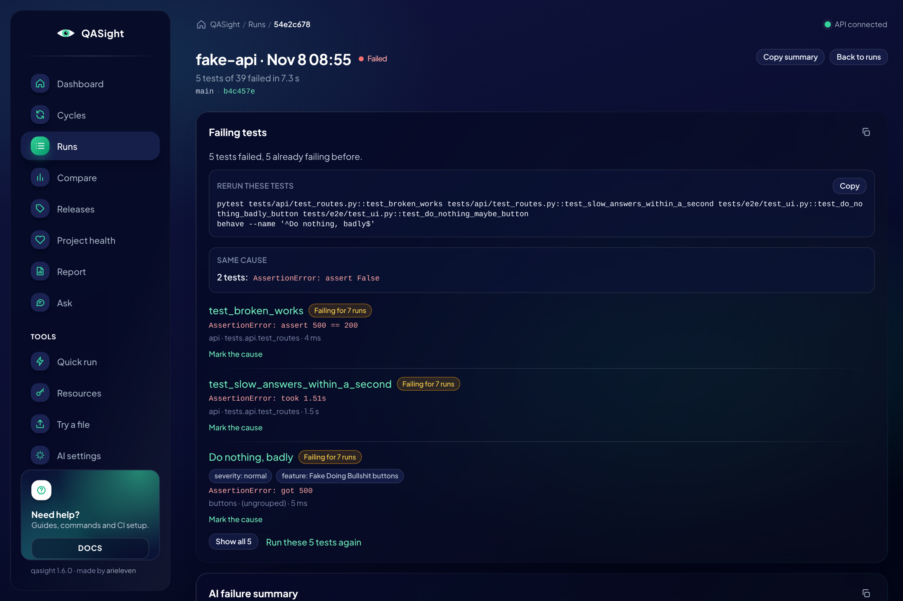

<h1>
  <picture>
    <source media="(prefers-color-scheme: dark)" srcset="docs/assets/qasight-logo-dark.png">
    
  </picture>
</h1>

**Every test run, remembered.** After a red build, know in a minute what's new, what's flaky and
what got slower, from your terminal, your CI or your coding agent.

[](https://github.com/arieleven/qasight/actions/workflows/ci.yml)
[](https://pypi.org/project/qasight/)
[](https://pypi.org/project/qasight/)
[](https://arieleven.github.io/qasight/docs/)
[](LICENSE)

**Try it with no install:** drop a JUnit XML file on <https://arieleven.github.io/qasight/try>
(read in your browser, nothing is uploaded), or open the [live demo](https://arieleven.github.io/qasight/).

[](https://arieleven.github.io/qasight/)

## Start

```bash
pip install 'qasight[api]'
qasight init        # finds your test runners, writes qasight.yaml and a CI workflow, records a first run
qasight ui          # what's new, what's flaky, what got slower
```

- **Already have result files?** `qasight ingest results.xml --cycle web` records JUnit XML, Jest,
  Playwright, `go test -json`, .NET and more. With pytest, `pytest --qasight` records every run.
- **Any test command, no config:** `qasight run -- npx jest --ci`.
- **Working with Claude Code, Cursor or VS Code?** `pip install 'qasight[mcp]' && qasight mcp install`
  gives your agent the run history. For scripts and agents: `qasight run --ci` streams NDJSON,
  exit codes `0`-`4` are a fixed contract, and `qasight help --json` describes every command.
- **No tests at hand?** `qasight demo` records eight sample runs and opens the UI.

`qasight init --dry-run` shows the files first; `--pr` opens the pull request that adds them.
More in [Getting Started](https://arieleven.github.io/qasight/docs/getting-started/).

## What you get

After every run, QASight compares it with the history and answers three questions:

| Question | Terminal | Web UI |
|----------|----------|--------|
| **What's new?** New failures and fixes since the last run | `qasight summary --cycle web` | Overview, Run detail, Compare |
| **What's flaky?** Tests that keep flipping, and quarantine for them | `qasight flaky --cycle web` | Cycle page, Test health |
| **What got slower?** Per-test durations over time | `qasight summary` (the change per test) | Overview, the page for each test |

In CI, the same answer lands where people already look: the job summary and one pull request comment
per cycle.

```yaml
- uses: arieleven/qasight@v1
  with:
    cycle: smoke
    comment-on-pr: "true"
```

GitLab, Jenkins and CircleCI: `qasight init --ci gitlab|jenkins|circleci`, then `qasight ci publish`
after the tests ([CI setup](https://arieleven.github.io/qasight/docs/processes-and-guides/ci-cd-pipeline-setup/)).

## When you need more

All of these are optional and off until you turn them on. `qasight help --all` lists every command.

| Need | How |
|------|-----|
| **Gate a release on code quality** | `qasight scorecard scan` scores the code with MegaLinter and up to 20 more tools, compares it with the last version and fails below a score ([Release Scorecard](https://arieleven.github.io/qasight/docs/cli-commands/command-reference/#qasight-scorecard)) |
| **AI failure summaries and questions** | Your own model: OpenAI, Anthropic, Claude Code on this machine, Ollama or any OpenAI-compatible server (`qasight ai setup`) |
| **One history for the whole team** | A team server with `docker compose up`, a [Helm chart](deploy/helm/qasight) or [Render](https://render.com/deploy?repo=https://github.com/arieleven/qasight); SSO, Postgres or MySQL ([Team Server](https://arieleven.github.io/qasight/docs/processes-and-guides/team-server/)) |
| **Reports for managers** | The Report page, or `qasight export pdf\|pptx\|xlsx\|html`; Slack, Teams and email with `qasight notify` |
| **Faster CI** | `qasight affected` runs only the tests a change touches, `qasight split` shards by time, `qasight lease` gives each worker its own VM, device or account |
| **Other tools** | Reporters for Allure, Extent, ReportPortal and TestBeats; OpenTelemetry; GitHub issues for flaky tests; [plugins](examples/plugin/) for more runners |
| **A closed network** | One offline bundle ([Closed Network Install](https://arieleven.github.io/qasight/docs/processes-and-guides/closed-network-install/)) |

## Who it's for

Teams whose CI goes red and someone has to ask "is this new, flaky or just slow?", who want it
self-hosted and free: a `pip install` on a laptop, or one `docker compose up` for a team. No account,
no cloud, MIT licensed.

Not the right pick if you want a hosted SaaS with nothing to run, or manual test case management.
[Compared with other tools](https://arieleven.github.io/qasight/docs/compared-with-other-tools/) says which tool fits better then.

## Learn more

- [Docs site](https://arieleven.github.io/qasight/docs/): [Getting Started](https://arieleven.github.io/qasight/docs/getting-started/), [Command Reference](https://arieleven.github.io/qasight/docs/cli-commands/command-reference/), [Setup Prompts](https://arieleven.github.io/qasight/docs/prompts-and-snippets/setup-prompts/) for AI coding assistants
- [ARCHITECTURE.md](ARCHITECTURE.md): one engine behind the CLI, the REST API (`/api/v1`) and the web UI
- [CHANGELOG.md](CHANGELOG.md): every change, release by release
- [CONTRIBUTING.md](CONTRIBUTING.md): setup, tests and the pre-PR checklist

Formerly Testosterone (`testo-core`): the `testo` command, `testosterone.yaml` and old imports keep
working ([rename notes](docs/Specs%20%26%20ADRs/Rename%20to%20QASight%20-%202026-11-04.md)).

## Contributors

Thank you to everyone who has helped make QASight better:

| Contributor | Contributions |
|-------------|---------------|
| [@arieleven](https://github.com/arieleven) | Creator and maintainer |
| [@evidentart](https://github.com/evidentart) | Run history records the repository each run tested ([#115](https://github.com/arieleven/qasight/pull/115), fixes [#102](https://github.com/arieleven/qasight/issues/102)); the starter config runs ordinary pytest tests ([#124](https://github.com/arieleven/qasight/pull/124), fixes [#100](https://github.com/arieleven/qasight/issues/100)) |
| [@drivepulator](https://github.com/drivepulator) | The format, AI review, test and deploy CI pipeline ([#39](https://github.com/arieleven/qasight/pull/39)) |

Want to join them? The [good first issues](https://github.com/arieleven/qasight/labels/good%20first%20issue)
are a friendly place to start, and [CONTRIBUTING.md](CONTRIBUTING.md) walks you through the setup.
