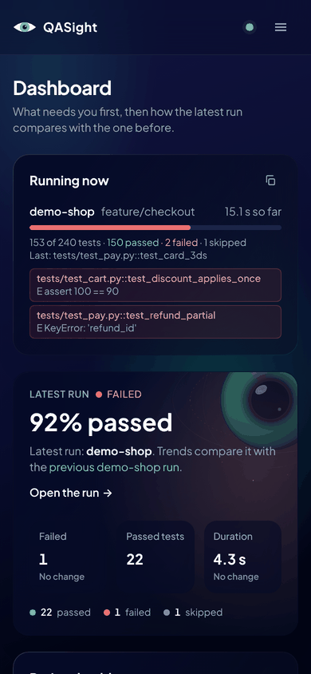

# Adoption Blockers

[Index](../Index.md) · [Specs & ADRs](README.md) · [Product Roadmap](../Roadmap%20&%20Strategy/Product%20Roadmap.md)

## Context

On 2026-11-12 the question was what still keeps QASight from being the tool a team reaches for first. The gaps from earlier reviews ([Feature Gaps and Quick Wins](../Roadmap%20&%20Strategy/Feature%20Gaps%20and%20Quick%20Wins%20-%202026-10-31.md) and the 2026-10-22 mainstream review: ingest from any CI, a team server, quarantine, Playwright, Jest and Cypress, alerts, badges, a GitHub Action) were largely built, so the remaining blockers were mostly not features. Compared with Allure TestOps, ReportPortal, Currents, Trunk and Datadog Test Optimization, ranked:

1. No users or social proof yet (one maintainer, no "used by"). Not code.
2. Many features, no single headline. Not code.
3. Self-hosting only: someone has to run a server, and there was no one-click host or Kubernetes chart.
4. Team readiness: no single sign-on, which most companies require before approving a tool; one server process.
5. Live reporting while tests run (ReportPortal) and richer Playwright artifacts (Currents).
6. Trust that the project lasts: no written promise about what stays stable.
7. The [release scorecard](Release%20Scorecard%20-%202026-11-12.md): no pull-request integration, a home-made score, slow on very large repositories, needs the whole server.

## Decision

Build what code can fix, in this order:

- **Single sign-on** with any OpenID Connect provider, on top of accounts ([Team Server § Single sign-on](../Processes%20&%20Guides/Team%20Server.md#single-sign-on)). Authorization-code flow with PKCE; the ID token is checked against the provider's keys with PyJWT (now `pyjwt[crypto]` in the `api` extra). The first sign-in creates an account named after the verified email with `TESTO_OIDC_DEFAULT_ROLE`; `TESTO_OIDC_ALLOWED_DOMAINS` limits who gets in. The callback ends with a small page instead of a redirect, because a `SameSite=Strict` cookie set at the end of a cross-site redirect chain isn't sent on that chain's last hop.
- **One-click hosting**: `render.yaml` (server image, Postgres, disk, generated token) behind a Deploy to Render link, and a Helm chart in `deploy/helm/qasight` (one replica, SQLite on the volume or an external Postgres, Secret or `existingSecret`, ingress, SSO values). CI lints and renders the chart (`helm_chart` job). Bare `postgres://` URLs, which hosts hand out, now use psycopg 3 (`normalize_database_url`).
- **A written stability promise**: [Stability and Deprecation Policy](../Processes%20&%20Guides/Stability%20and%20Deprecation%20Policy.md) (what is stable in 1.x, six months and two minor releases of deprecation, removal only in 2.0).
- **Live results** while pytest runs ([Team Server § Live results](../Processes%20&%20Guides/Team%20Server.md#live-results)): `/api/v1/live-runs` keeps running sessions in memory (`qasight_api/live_runs.py`), the plugin sends results in batches through `qasight/services/live_client.py` and stops at the first error, and the dashboard's **Running now** card polls every 3 seconds. The finished session is still recorded by the normal upload, so live results add no second way to record a run. In memory on purpose: a session lasts minutes and the server is one process.
- **The scorecard where developers look** ([CI-CD Pipeline Setup § GitHub Action](../Processes%20&%20Guides/CI-CD%20Pipeline%20Setup.md#github-action)): the Action's `scorecard` input scans, writes the job summary and one pull request comment, and gates with `scorecard-min-score` and `scorecard-no-new` (only new findings fail a pull request, as in SonarQube's "clean as you code"). `qasight scorecard show --format sarif|html|svg` (`qasight/services/scorecard/export.py`) gives findings to GitHub code scanning, a page that needs no server, and a README badge; the server serves the badge at `/api/v1/scorecard/badge.svg`.

Not built: anything for blockers 1 and 2 (launch and positioning are people's work), scanning only the files a pull request changed (MegaLinter's `VALIDATE_ALL_CODEBASE=false` could, but the score is per version, not per diff; `--no-new` covers the gate), calibrating the score on well-known repositories, and several server processes (the run manager, queue and live streams are in memory; the chart says so and runs one replica).

## Consequences

- A team watching a long suite sees failures minutes earlier, without opening the CI log.

- A company can put QASight behind its own identity provider and give people roles, without sharing the token.
- Trying a team server no longer needs a machine with Docker: a Render account or a Kubernetes cluster is enough. The Render button needs the `qasight-server` image on GHCR to be public.
- Breaking a stable surface in 1.x is now a policy violation; deprecations need a warning and a CHANGELOG entry.
