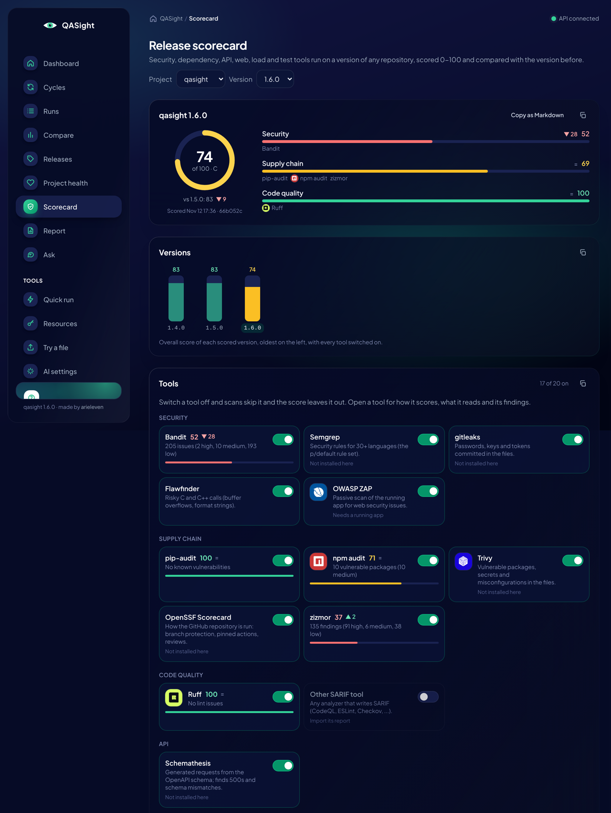
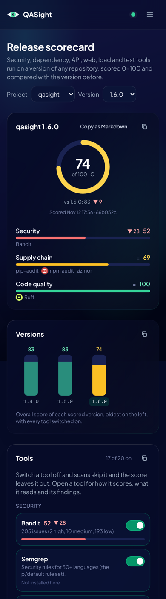

# Release Scorecard

## Context

Before a release (1.5 to 1.6), the repo review tools were run by hand: Bandit, pip-audit, zizmor, Schemathesis, ZAP, Lighthouse, axe, load tests, mutation testing. Their reports were read one by one, and nothing said whether the release was better or worse than the last one. A survey on 2026-11-12 found the practice ("release gate", "production readiness review") is well known, and parts exist (SonarQube quality gates, OpenSSF Scorecard, DefectDojo, Cortex and OpsLevel scorecards, GitLab Ultimate's scanners), but no tool runs static and live checks on a version, gives one score per version and compares it with the version before. That fits QASight, which already keeps history and compares runs and [releases](Test%20Labels,%20Environments%20and%20Releases%20-%202026-11-02.md).

The same should work on any repository, not only the one QASight tests: a git URL such as `https://github.com/torvalds/linux` or a folder.

## Decision

- **One score per tool, per version, per project.** `qasight/services/scorecard/` keeps a registry of 20 tools (`tools.py`), a parser per report format (`parsers.py`: SARIF, Bandit, Ruff, pip-audit, npm audit, gitleaks, Trivy, OpenSSF Scorecard, ZAP, axe, Lighthouse, k6, Locust, JUnit, coverage, mutation). Results live in the run-history database, table `scorecard_result` (revision `0007`), one row per project, version and tool; a newer report replaces it.
- **Scores are computed, not judged.** Findings tools lose points per kind of finding by severity (critical 25, high 10, medium 4, low 1), repeats on a log scale, on a curve where 100 points halve the score: never a flat 0, so a big repository's versions stay comparable. Ratio tools (Lighthouse, coverage, mutation, Schemathesis, Scorecard, load) use their own share. A category's score is the mean of its switched-on tools; the overall score is the mean of the categories, so ten linters don't outweigh one load test. No AI.
- **Versions compare by number.** The previous version is the one before by PEP 440 order (`1.10` after `1.9`) when every version parses, else by when it was first scored.
- **Tools switch on and off** (table `scorecard_tool`): a switched-off tool is skipped by scans and left out of the score, but still shown.
- **Scans run tools, not cycles.** `qasight scorecard scan TARGET` (and the UI's "Scan a repository", `POST /api/v1/scorecard/scans`) clones a git URL shallow or uses a folder, detects its languages (python, node, c, GitHub Actions), and runs the switched-on tools that fit and are installed, each with a time limit. App tools (ZAP, Lighthouse, axe, k6, Schemathesis) run only with `--url` / `--openapi`. A scan is not a cycle on purpose: these tools aren't test runners, their exit codes mean "found something", and their results are scores, not test cases. Cycles still go through `CycleRunService` only. QASight never installs a tool; a missing one is listed with its install command.
- **Bring your own report** for tools whose run is project-specific (coverage, mutation testing, Locust, any SARIF or JUnit file): `qasight scorecard import TOOL FILE`, or `--server` to send it to a team server (`POST /api/v1/scorecard/results`).
- **The gate is `qasight scorecard show` (or `scan`) with thresholds**: `--min-score`, `--min-tool`, `--no-drop`; exit `1` when it fails. The summary is Markdown (`--format markdown`, the job summary in GitHub Actions, `GET /api/v1/scorecard/markdown`).
- **UI**: a Scorecard page (`/scorecard`) with the score ring, categories and the change since the previous version, a bar per version, every tool with its switch, and the scan form. A tool shows its own logo only when one exists in Simple Icons (CC0 path data, `frontend/src/features/scorecard/brandMarks.ts`: ZAP, Lighthouse, k6, Trivy, npm, Ruff); the others show no logo rather than a made-up one.
- **CI**: `release-gate.yml` has a `release_scorecard` job that scores the last release tag and the commit, and fails under `min_score` (default 60) or, with `no_drop`, when a tool got worse. The Pages demo scores QASight's last two releases, `main` and fake-api with the PyPI tools (Bandit, pip-audit, zizmor, Ruff).

## Consequences

- First real scores (2026-11-12, Bandit, pip-audit, npm audit, zizmor, Ruff): QASight 1.4.0 and 1.5.0 scored 83, 1.6.0 scored 74, because Bandit found two `shell=True` calls added in 1.6 (`qasight/cli/commands/try_cmd.py`, `qasight/resources/client.py`); zizmor flags unpinned actions in every version. fake-api scored 100.





- A scan on the server runs commands there, like a cycle does, so starting one needs the token or a `runner` account. Scans started from the UI are kept in memory until the server restarts; their results are in the database.
- Tools that need an account or a network service (Semgrep's rule registry, OpenSSF Scorecard's GitHub token, ZAP's Docker image) only run where those are available.
- Not done: running app tools against a server the scan starts itself, per-tool weights, and a scorecard on the Releases page.

## Follow-up fixes from the first outside run

On 2026-11-12 the scorecard ran on three outside repositories (griffithlab/civic-v2, cBioPortal/cbioportal, cBioPortal/cbioportal-frontend). It didn't crash, but the scores misled: CIViC's Security 98 came from Bandit on one example script, and cbioportal-frontend's 12,442 "secrets" were test data. A redesign around MegaLinter and OSV-Scanner (Taltal's choice, 2026-11-12) replaces the scorecard's own language and tool list, so the follow-up pull request keeps only the fixes that don't depend on which engine runs the tools:

- **Coverage.** A scan stores which tools fit the repository and which ran (table `scorecard_coverage`, revision `0008`). The scorecard shows "N of M tools that fit this repository ran", and when fewer than half ran the grade is capped at C (the score itself is unchanged). The cap is in `report.capped_grade` and mirrored by the UI's `cappedGrade`.
- **gitleaks.** Files under test, fixture and mock folders, or named like them (`expressionTestData.json`, `keys.spec.ts`), are left out and counted separately. Severity is per rule: private and cloud keys critical, provider tokens high, `generic-*` and JWTs medium. Each distinct secret counts once.
- **Why a tool failed.** The error keeps the lines of the tool's output that say why, plus a hint (Semgrep's `p/default` needs semgrep.dev).
- **History database.** The default stays `./testo_history.db` (changing it would move every user's run history), but `scan`, `import` and `show` now print the database they use.
- **"Not run"** lists each tool once with its reason; the progress lines only say skipped or failed.
- **Ignore file.** `scorecard-ignore.yml` at the repository root (or `--ignore FILE`) accepts known false positives for findings tools, which are then left out and the tool rescored:

```yaml
ignore:
  - tool: zizmor
    rule: dangerous-triggers                       # the finding's title: a rule id or package; globs work
    path: .github/workflows/release-management.yml # the file in its location; globs work
    reason: pull_request_target that checks nothing out
```

Each entry needs a `tool` and a `rule`, a `path` or both. Ratio tools (Lighthouse, coverage, ...) can't be ignored this way.
