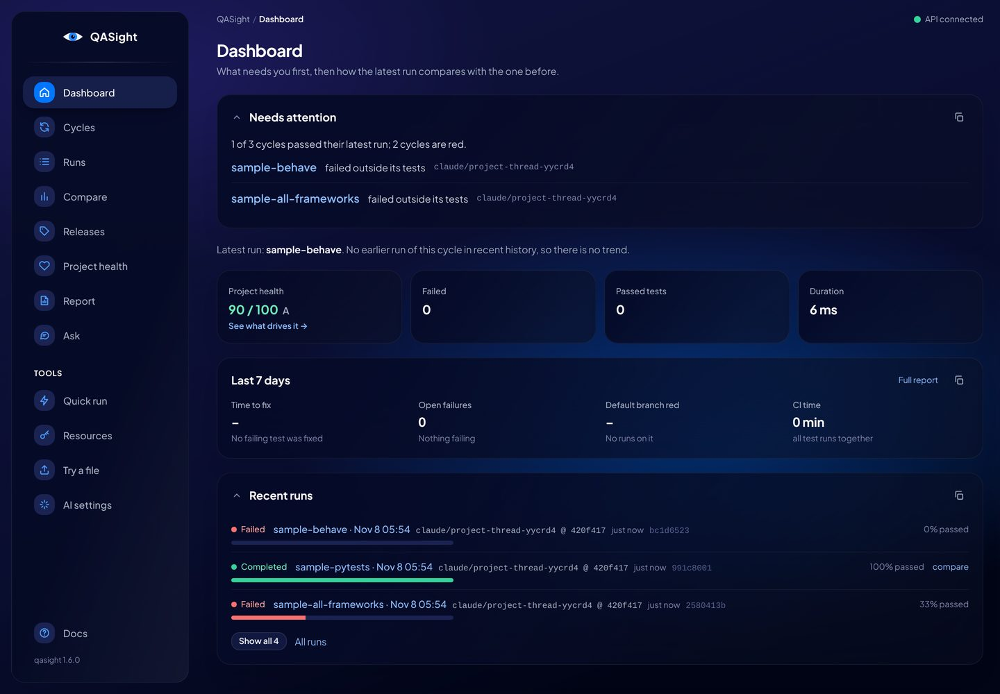
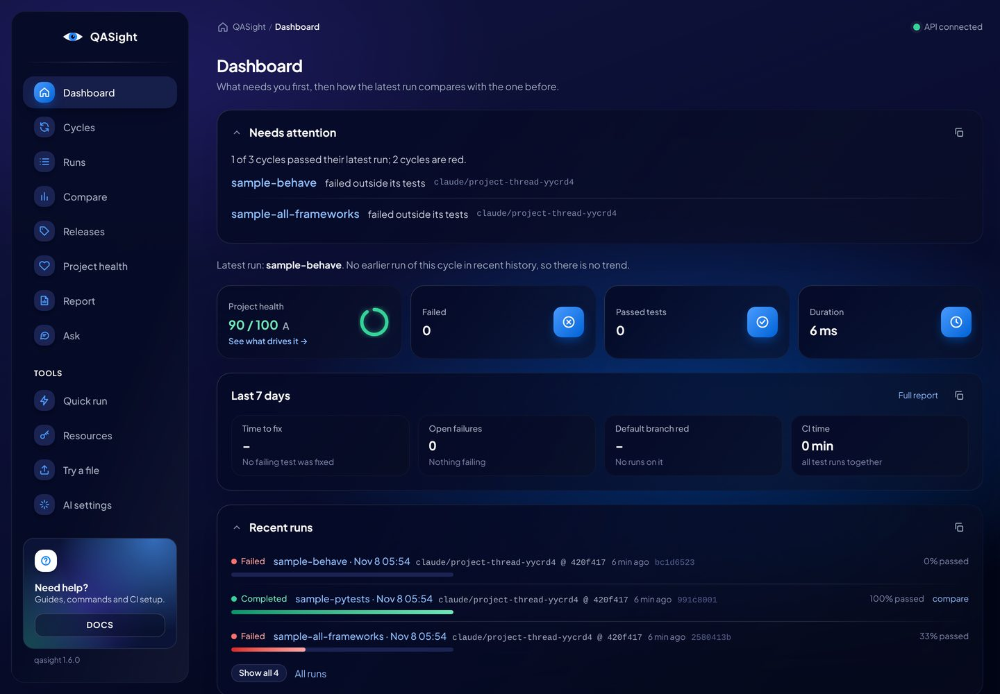
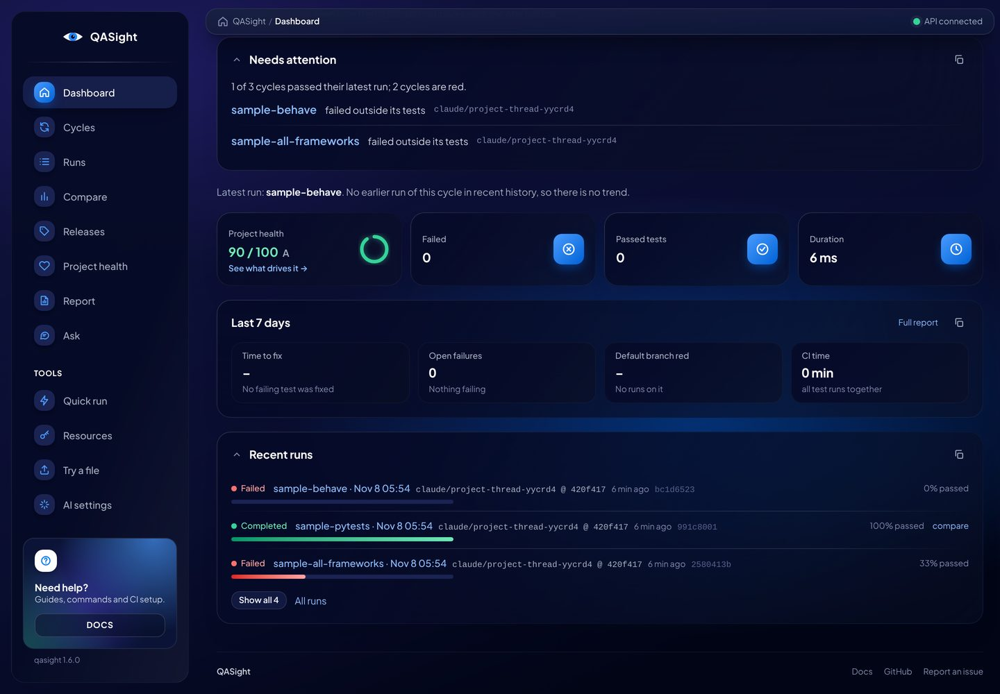
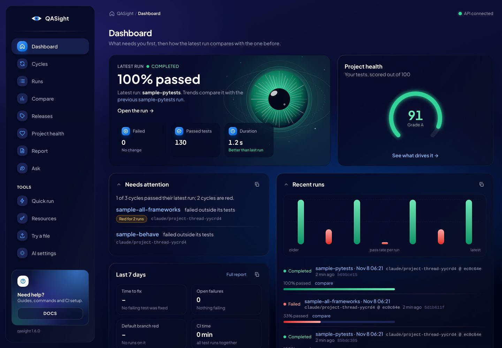
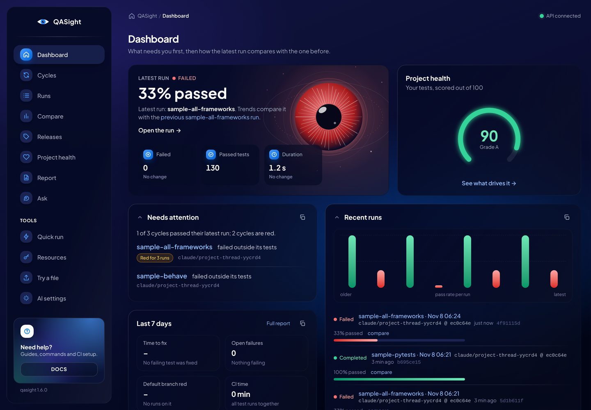
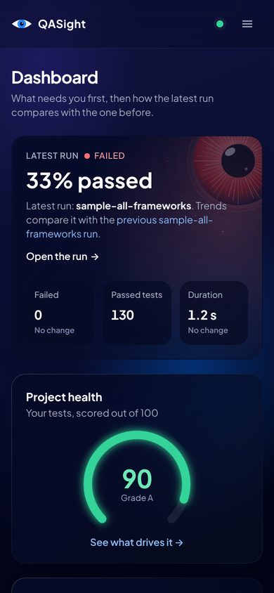
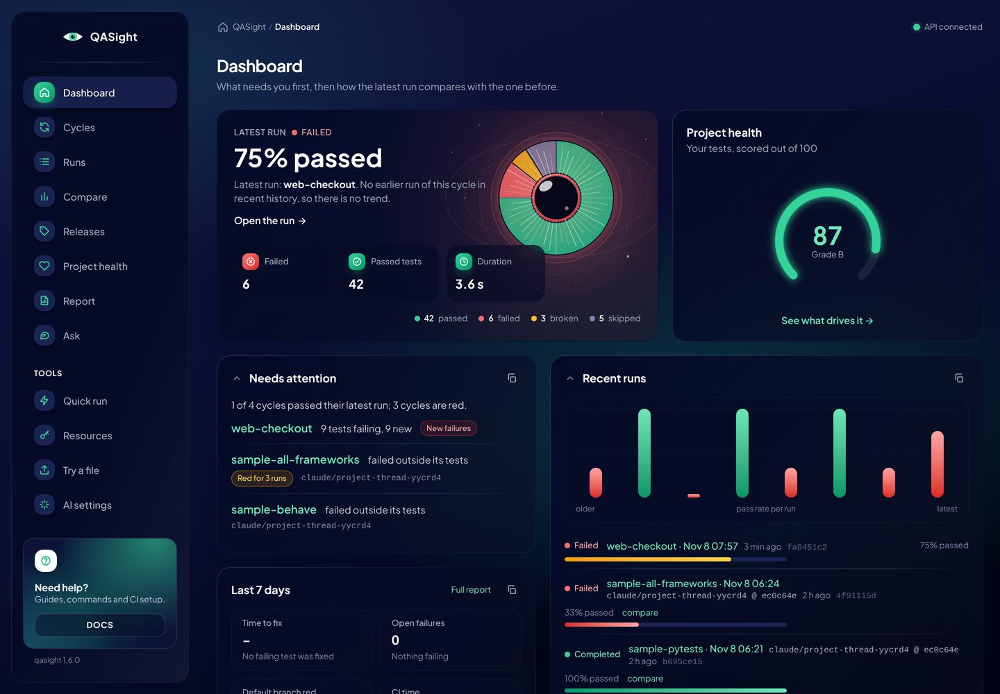
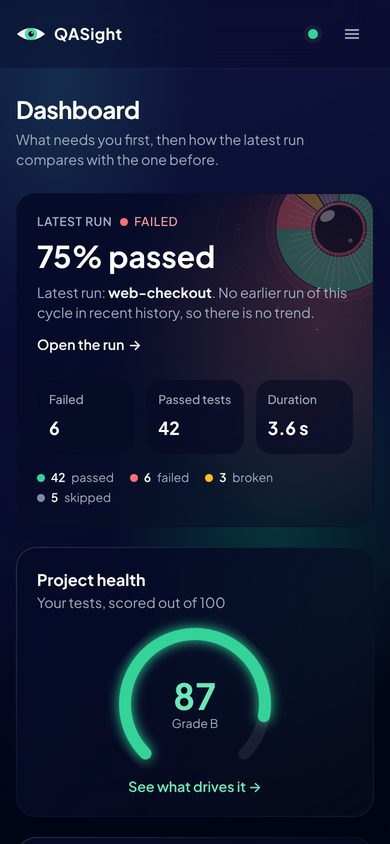
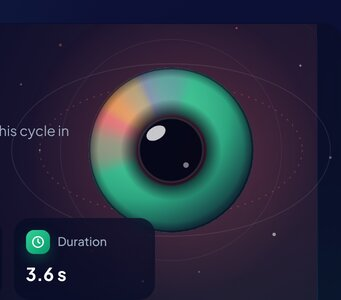

# UI Polish - 2026-11-08

[Index](../Index.md) · Taltal's note on 2026-11-08: the [UI Restyle](UI%20Restyle%20-%202026-10-19.md) took the base of the Vision UI Dashboard look (navy, glass cards, sidebar) but left out many small touches that make the reference feel finished. This pass adds the ones that fit QASight.

## Context

The reference is the free [Vision UI Dashboard React](https://demos.creative-tim.com/vision-ui-dashboard-react/#/dashboard) demo by Simmmple and Creative Tim. Its repository's `LICENSE.md` is MIT. QASight copies no code, images or icons from it: the frontend is Tailwind and hand-written SVG, and the only shared values are a few CSS gradient stops and the brand blue `#0075ff` (since replaced by green, below), which are facts of a look, not a copied work. So no notice is required. Crediting the inspiration here and in the [UI Restyle](UI%20Restyle%20-%202026-10-19.md) note is enough.

Compared side by side, the reference had these touches that QASight lacked:

| Touch in the reference | What QASight had |
| --- | --- |
| Card edges are a hairline of light, brightest at one corner, fading out | A flat 6% white border |
| KPI cards carry a blue icon tile with a soft glow on the right | No icons (removed as decoration in [Product to Ten](Product%20to%20Ten%20-%202026-10-25.md)) |
| Gauges (rings) next to scores | The health score as text only |
| Small numbers sit in darker inner tiles inside a card | Numbers straight on the card |
| Row dividers fade out at both ends | Hard 5% lines |
| The top bar sticks and turns to glass as the page scrolls | A breadcrumb that scrolls away |
| A home icon in the breadcrumb | Text only |
| Gradient buttons and progress bars with a glow | Flat colour |
| A lit "Need help?" card at the bottom of the sidebar | A plain Docs link |
| A footer line under every page | Nothing; phones had no Docs link at all |

## Decision

Styling only: no route, API, copy or behaviour change beyond the new footer links.

- **`frontend/src/styles.css`** gains `glass-card`'s light edge (a masked `::before` ring, so `glass-card` is now `position: relative`), and three utilities: `inset-tile` (the darker well), `divide-fade` (rows split by a fading hairline; used instead of `divide-y divide-white/5` on lists, not on table bodies, where `border-image` doesn't apply) and `brand-tile` (the brand gradient with a glow, for icon tiles and the active nav icon). Selection and scrollbars take the app's colours.
- **Dashboard KPI cards** show an icon tile again, but each icon means something: a cross for Failed (red when anything failed), a check for Passed tests, a clock for Duration. Project health gets a ring in the score's colour instead. Tiles and ring are hidden on phones, where the two-column grid is too narrow for them.
- **Last 7 days** numbers sit in `inset-tile` wells.
- **AppShell**: the desktop breadcrumb bar is sticky and becomes a glass strip after 8 px of scroll; the phone top bar darkens the same way. The breadcrumb starts with a home icon. The sidebar's Docs link is a "Need help?" card with the eye's blue and green glow. Every page ends with a footer (QASight, Docs, GitHub, Report an issue). The version note under the sidebar adds "made by arieleven", linking to https://github.com/arieleven (Taltal's ask).
- **Buttons and bars**: primary buttons are a brand gradient whose glow grows on hover; pass-rate bars are rounded gradients.

### Dashboard layout (second round, same day)

Taltal then asked for a less symmetrical dashboard with more graphics up front, something visual in the spirit of the reference's jellyfish card. The dashboard is now laid out in uneven columns instead of equal rows of boxes:

- **Latest run hero** (`LatestRunHero`, 7 of 12 columns): the latest run's pass rate in big type, its status, the trend sentence, "Open the run", and three small stats (Failed, Passed tests, Duration, with icon tiles). Behind it, `IrisArt` in `features/dashboard/DashboardVisuals.tsx`: original SVG art of QASight's eye as a glowing iris, green when the latest run passed, red when it failed, blue with no result. On phones the art shrinks into the corner so the text stays readable.
- **Project health gauge** (5 columns): an open ring `Gauge` that fills to the score, with the score and grade inside, replacing the KPI tile.
- **Needs attention and Last 7 days** stack in a narrow left column (5 of 12); **Recent runs** fills the wider right one and opens with `RunBars`, a bar per recent run (height is the pass rate, colour the result, each bar links to its run), above the 3-row list.

The separate four-tile KPI row is gone; its numbers live in the hero. Same data and endpoints as before.

### Green accent and the results-pie iris (third round, same day)

Taltal asked about the palette and the eye. The electric blue `#0075ff` was the template's own colour, so the app still read as the template. Three options were rendered on the real dashboard (current blue, the eye's green, aqua teal; then green on navy and on a dark green base), and Taltal picked **green on navy**.

- `brand` in `frontend/tailwind.config.ts` is now the logo iris's green (`#34d399` at 400, `#10b981` at 500); the navy `ink` scale is unchanged. The page glow, `brand-tile`, the card edge, text selection and the help card follow it, and `EYE_BRAND_GREEN` replaces `EYE_BRAND_BLUE` as the logo's iris (the health page still tints it by score, grey with no score).
- Primary buttons are bright green with dark text (`text-ink-950`): white on green fails WCAG contrast. The skip link and the AI settings save button do the same.
- The accent shares a family with "passed". Failures stay red and warnings amber, so the signal still reads.
- **Pie iris.** `IrisArt` takes `slices`: the iris becomes a ring split by the latest run's passed, failed, broken and skipped tests (the same green, red, amber and grey), each slice with its count on hover and a tiny minimum so a single broken test still shows. After Taltal's review the slices fade into each other (drawn as thin wedges, since SVG has no conic gradient) and the ring is shaded with a top-left light and a dark curve into the pupil, so it reads as a rounded 3D iris instead of a flat chart. Taltal then chose to drop the run-coloured rim and the white fibres on the pie, so only the blended results show. A legend under the hero lists the counts. The counts come from `GET /api/v1/runs` (the dashboard overview only has passed and failed); no API change.

Not changed: the printed and exported report (white paper, its own colours), the docs site theme and the README screenshots, which still show blue until they are retaken.

Not taken from the reference: the photo hero card, the settings button, avatars and the RTL page, which are template demo content with no QASight meaning.

## Consequences

- New cards get the light edge for free through `Card` or `glass-card`. Something absolutely positioned inside a `glass-card` now anchors to the card.
- New lists should use `divide-fade`; new KPI-like numbers can use `inset-tile`.
- Screenshots: before, after, and after with the sticky glass bar, in `docs/assets/ui-polish-2026-11-08/`.

